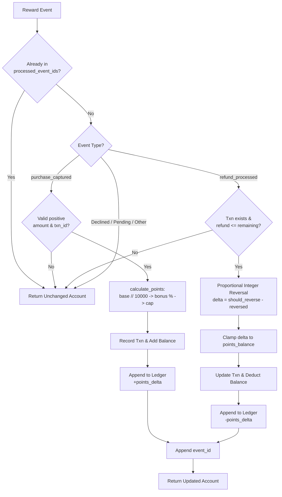

# Architecture Notes — RewardBook

## Project map
- `models.py`: Defines account factory `new_account(account_id)` initializing data structures.
- `service.py`: Core computational engine containing `calculate_points`, `apply_reward_event`, `flag_repeat_transactions`, and `generate_account_statement_csv`.
- `fixtures.py`: Provides mock accounts, transactions, and rules for offline demonstration.
- `main.py`: Entrypoint for offline demo execution.
- `data/records.json`: Expanded synthetic dataset covering 40 accounts, 180 repeat-pattern transactions, 264 reward events, and 8 rule cases.
- `tests/`: Automated unit and acceptance tests (`test_contract.py`, `test_acceptance_matrix.py`, `test_regression_and_edge_cases.py`).

## Data model
```python
Account: {
    "account_id": str,
    "points_balance": int,
    "processed_event_ids": list[str],
    "transactions": {
        "<transaction_id>": {
            "amount_paise": int,
            "awarded_points": int,
            "reversed_points": int,
            "refunded_paise": int,
        }
    },
    "ledger": [
        {
            "event_id": str,
            "type": str,  # "purchase_captured" | "refund_processed"
            "points_delta": int,
        }
    ]
}
```

## Data flow
1. **Event Ingestion:** Event payloads (`event_id`, `type`, `transaction_id`, `amount_paise`) arrive at `apply_reward_event`.
2. **Idempotency Verification:** Checks if `event_id` is in `processed_event_ids`. If already present, skips processing and returns state immediately.
3. **Event Qualification:**
   - If `type == "purchase_captured"`, validates non-negative positive amount and computes points using integer floor division, promotional bonus percentage, and optional maximum cap.
   - If `type == "refund_processed"`, verifies that transaction exists, validates that cumulative refunds do not exceed original purchase amount, and computes integer proportional reversal.
4. **State Transition & Ledger Logging:** Updates transaction stats, modifies `points_balance` (guarded against negative values), appends an immutable entry to `ledger`, and registers `event_id` into `processed_event_ids`.
5. **Repeat Transaction Detection:** `flag_repeat_transactions` groups historical transactions by account, date, and paise amount, producing sorted review alerts for any bucket exceeding the configurable threshold.

## Storage design
- In-memory nested dictionary representation optimized for JSON serialization.
- Transactions are indexed by `transaction_id` for $O(1)$ state retrieval during refund processing.
- Ledger entries form an append-only linear audit log representing all state-modifying actions.

## Diagram


## Three improvements suggested
1. **Set-backed Idempotency Index:** Maintain an internal hash set for `processed_event_ids` to achieve $O(1)$ lookup performance when account event history scales into thousands of events.
2. **Persistent Event-Sourcing Ledger:** Store raw immutable ledger events in an append-only store (e.g. SQLite / PostgreSQL) and derive point balances dynamically via event replay or materialized views.
3. **Negative Balance / Clawback Reserve Tracking:** When a refund occurs on an account with insufficient points balance, record an "uncollected reversal liability" to automatically claw back points from future purchases.

