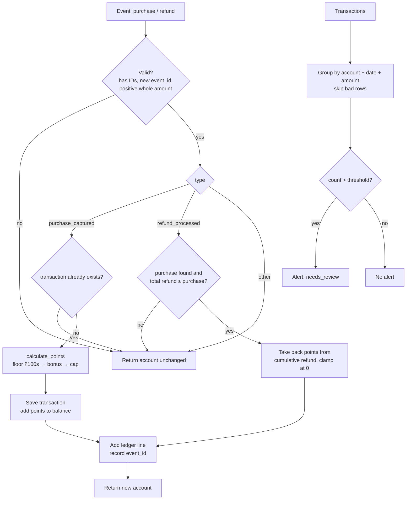

# Architecture Notes

## Project map

| File / folder | What it does |
|---|---|
| `service.py` | All the business logic. `calculate_points` (points for one purchase), `apply_reward_event` (applies a purchase or refund to an account), `flag_repeat_transactions` (repeat-payment alerts), `repeat_threshold_from_config` (reads the alert threshold), plus small helpers: `_is_int`, `_is_hashable`, `_ledger_entry`. |
| `models.py` | `new_account(account_id)`, which creates an empty account dict. |
| `fixtures.py` | Small sample account, rules and 3 transactions used by the demo. |
| `main.py` | Offline demo (`python -m main`). Prints one points example and the repeat alerts. `--threshold N` changes the alert threshold. |
| `data/records.json` | Bigger synthetic dataset: 264 reward events, 180 repeat-pattern transactions, 8 rule cases, `repeat_alert_threshold`. Used by tests. |
| `tests/test_contract.py`, `tests/test_acceptance_matrix.py` | The original tests from the starter (214). |
| `tests/test_regressions.py` | My regression tests for each fix (63). |
| `tests/test_threshold_config.py` | Tests for the configurable threshold (15). |
| `tests/test_stress.py` | Randomized tests that check rules that must always hold (34). |
| `.github/workflows/tests.yml` | CI: runs the demo and `pytest` on Python 3.11 and publishes the test counts. |
| `scripts/build_problem_statement_pdf.py`, `docs/` | Builds the problem-statement PDF. Not part of the app. |

## Data model

Everything is a plain Python `dict`. All money is a **whole number of paise** (₹1 = 100 paise), never a float.

**Rules**
```python
{'points_per_100_rupees': 1, 'bonus_percent': 10, 'cap_points': 100}   # cap_points can be None = no cap
```

**Event** (input to `apply_reward_event`)
```python
{'event_id': 'EV-1', 'type': 'purchase_captured' | 'refund_processed' | ...,
 'transaction_id': 'TX-9', 'amount_paise': 259900}
```

**Account** (from `new_account`)
```python
{
  'account_id': 'ACCT-1001',
  'points_balance': 96,
  'processed_event_ids': ['EV-1', 'EV-2'],        # stops the same event counting twice
  'transactions': {                                # one entry per purchase
      'TX-9': {'amount_paise': 259900, 'awarded_points': 156,
               'refunded_paise': 100000, 'reversed_points': 60}
  },
  'ledger': [                                      # one line per accepted event
      {'event_id': 'EV-2', 'type': 'refund_processed', 'transaction_id': 'TX-9',
       'amount_paise': 100000, 'points_delta': -60, 'balance_after': 96}
  ]
}
```

**Transaction** (input to `flag_repeat_transactions`) and **alert** (output)
```python
{'transaction_id': 'TX-1', 'account_id': 'ACCT-1001', 'date': '2026-10-21', 'amount_paise': 259900}
{'account_id': 'ACCT-1001', 'date': '2026-10-21', 'amount_paise': 259900,
 'transaction_ids': ['TX-1', 'TX-2', 'TX-3'], 'count': 3, 'status': 'needs_review'}
```

Rules that always hold (checked in `tests/test_stress.py`):
- `points_balance` = sum of all ledger `points_delta` values, and is never negative.
- Each ledger line's `balance_after` is the running total.
- For every transaction: `0 ≤ refunded_paise ≤ amount_paise` and `0 ≤ reversed_points ≤ awarded_points`.

## Data flow

**Points:** `amount_paise // 10000` (full ₹100s) × `points_per_100_rupees` → add the bonus (`× (100 + bonus) // 100`) → apply the cap last. Any invalid input gives 0.

**Applying an event:** `apply_reward_event(account, event, rules)`
1. Make a `deepcopy` of the account, so the caller's account is never changed. A non-dict account (like `None`) starts as an empty one.
2. Reject the event (return the copy unchanged) if:
   - it isn't a dict
   - `event_id` or `transaction_id` is missing or not hashable
   - `event_id` was already processed
   - the amount isn't a positive whole number
3. `purchase_captured`: if this `transaction_id` already exists, ignore it. Otherwise call `calculate_points`, save the transaction and add the points.
4. `refund_processed`: find the purchase and reject the refund if the total refunded would go over the purchase amount. Points to take back = `awarded × total_refunded // amount`, minus what was already taken back, limited to the current balance and never below 0, so a refund can't add points.
5. Any other type: ignore it.
6. For accepted events only: add a ledger line and record the `event_id`.

**Repeat alerts:** `flag_repeat_transactions(transactions, threshold)`. Skip bad rows (missing fields, amount ≤ 0, a list/dict account, date or `transaction_id`) and collect each group's IDs in a set, so each one counts once and huge groups stay fast. Group by `(account_id, date, amount_paise)`, keep groups with **more than** `threshold` items, sort them, and mark each one `needs_review`. Alerts are only for a human to look at; they never block a payment.

**Threshold:** default 2. It can come from `repeat_alert_threshold` in a config dict (`repeat_threshold_from_config`) or `python -m main --threshold N`. Anything below 1 counts as 1; a non-integer threshold falls back to 2.

## Storage design

There's no database. Everything is in memory, and the functions are **pure**: they take an account and return a new one. Whoever calls them is responsible for keeping the result. The test data is read from `data/records.json`.

Why it's built like this: it's easy to test (same input, same output), and a bad event can't half-update an account.

The downside is that every event copies the whole account. Replaying 1,000 / 2,000 / 4,000 / 8,000 events into one account took about 0.7 s / 2.8 s / 11.2 s / 45.4 s, so it gets slow as the history grows (see `optimizations.md`). In a real system I'd store accounts, transactions and ledger lines in a database table, with a unique index on `event_id` for the duplicate check.

## Diagram



## Three improvements suggested
1. **Faster duplicate check and no full copy.** Keep `processed_event_ids` in a set (or a database unique index) and only copy the parts of the account that change. This fixes the slowdown measured above. I'd time it again with 10k and 100k events.
2. **Track spent points.** Right now, if points are already spent, a refund only takes back what's left in the balance and the rest is lost. A "points owed" field (negative carry-over) would make refunds always correct.
3. **Use dataclasses instead of plain dicts.** For `Account`, `Transaction` and `LedgerEntry`, a typo in a field name would then give an error instead of quietly creating a new key, and the editor would help with autocomplete.
