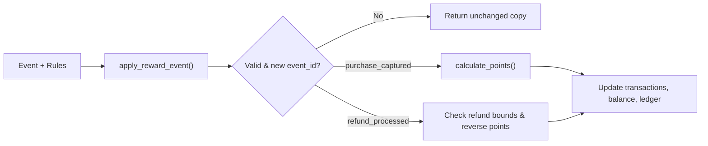

# Architecture Notes

## Project map
- `models.py`: Defines `new_account(account_id)` which returns an empty account dictionary.
- `service.py`: Contains the main logic:
  - `_is_strict_int(value)`: Checks that a value is an `int` and not a `bool`.
  - `calculate_points`: Computes base points, bonus points, and cap using integer floor division.
  - `apply_reward_event`: Processes `purchase_captured` and `refund_processed` events on a copy of the account dict.
  - `flag_repeat_transactions`: Groups transactions by `(account_id, date, amount_paise)` and flags groups exceeding `threshold`.
- `fixtures.py` and `main.py`: Sample inputs and command-line demo script.
- `data/records.json`: Synthetic dataset with 40 accounts, 180 repeat transactions, and 264 reward events.
- `tests/test_contract.py` and `tests/test_acceptance_matrix.py`: Test suites (218 tests total).

## Data model
- **Account dict**: `{"account_id": str, "points_balance": int, "processed_event_ids": list[str], "transactions": dict[str, dict], "ledger": list[dict]}`
- **Transaction entry**: `{"amount_paise": int, "awarded_points": int, "reversed_points": int, "refunded_paise": int}`
- **Ledger entry**: `{"event_id": str, "type": str, "points_delta": int}`
- **Repeat alert**: `{"account_id": str, "date": str, "amount_paise": int, "transaction_ids": list[str]}`

## Data flow
1. `apply_reward_event` receives `(account, event, rules)` and makes a deep copy of `account`.
2. It checks that `event_id` and `transaction_id` are valid strings and that `event_id` is not already in `processed_event_ids`.
3. For `purchase_captured`, it calls `calculate_points`, saves the transaction, adds to `points_balance`, and appends to `ledger` and `processed_event_ids`.
4. For `refund_processed`, it checks that the transaction exists and `refunded_paise + refund <= amount_paise`, reverses the proportional points, and appends to `ledger` and `processed_event_ids`.
5. `flag_repeat_transactions` scans a list of transactions, groups distinct `transaction_id`s by `(account_id, date, amount_paise)`, and returns groups with `len(ids) > threshold`.

## Storage design
- In-memory Python dictionaries and lists using basic JSON-compatible types (`str`, `int`, `list`, `dict`).

## Diagram

## Three improvements suggested
1. Copy only modified keys (`transactions`, `ledger`, `processed_event_ids`) instead of running `deepcopy(account)` on every event.
2. Keep a set alongside `processed_event_ids` so checking for duplicate `event_id`s is `O(1)` instead of `O(N)`.
3. Add a simple database or file persistence layer so account balances and ledgers survive across runs.
