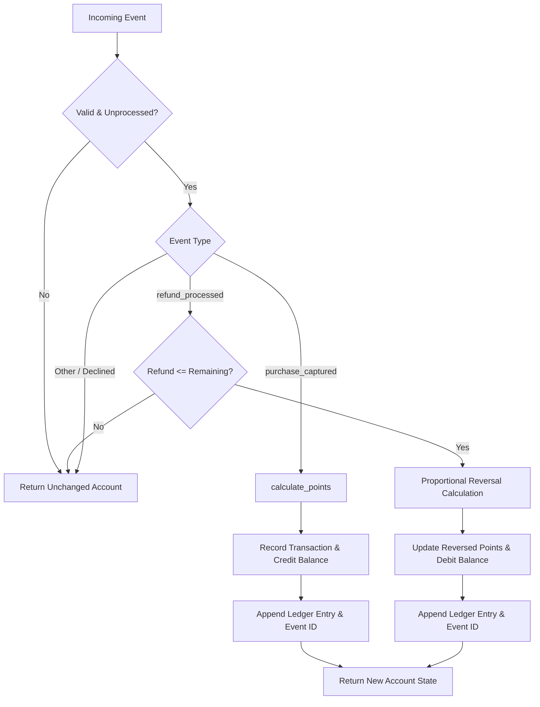

# Architecture Notes

## Project map
- `service.py`: Core domain logic for points calculation, event application, refund reversal, repeat transaction alerts, and statement generation.
- `models.py`: Account entity factory (`new_account`) initializing state dictionaries.
- `fixtures.py`: Sample data fixtures for testing and standalone demonstration.
- `main.py`: Entrypoint demonstrating calculation and repeat transaction detection.
- `tests/`: Acceptance test suite (`test_contract.py`, `test_acceptance_matrix.py`) and regression suite (`test_regression.py`).
- `data/`: Synthetic dataset (`records.json`) containing 40 accounts, 180 transactions, and 264 reward events.

## Data model
- **Account:**
  - `account_id` (str): Unique customer account identifier.
  - `points_balance` (int): Non-negative balance of earned loyalty points.
  - `processed_event_ids` (list[str]): Deduplication registry of processed events.
  - `transactions` (dict[str, dict]): Map of `transaction_id` to transaction state:
    - `amount_paise` (int): Captured transaction amount in paise.
    - `awarded_points` (int): Loyalty points originally awarded.
    - `reversed_points` (int): Cumulative points reversed by refunds.
    - `refunded_paise` (int): Cumulative paise refunded.
  - `ledger` (list[dict]): Immutable append-only audit log:
    - `event_id` (str), `type` (str), `points_delta` (int).

## Data flow
1. **Event Ingestion:** `apply_reward_event(account, event, rules)` receives an account dictionary and event payload.
2. **Validation & Idempotency:** Validates non-empty identifiers; rejects if `event_id` exists in `processed_event_ids` or parameters are invalid.
3. **Domain Processing:**
   - For `purchase_captured`: Calls `calculate_points()`, sets transaction state, increases `points_balance`, appends positive ledger delta.
   - For `refund_processed`: Checks transaction existence, validates refund bounds, calculates cumulative proportional reversal, decreases `points_balance` (bounded at 0), appends negative ledger delta.
4. **State Transition:** Returns updated account copy while maintaining input immutability.

## Storage design
In-memory dictionary state structured for clean JSON serialization. Easily maps to relational schema:
- `accounts` table: `account_id (PK)`, `points_balance`.
- `transactions` table: `transaction_id (PK)`, `account_id (FK)`, `amount_paise`, `awarded_points`, `reversed_points`, `refunded_paise`.
- `ledger` table: `id (PK)`, `account_id (FK)`, `event_id`, `type`, `points_delta`, `created_at`.

## Diagram

## Three improvements suggested
1. **Relational Database Persistence:** Back the ledger and transaction state with an ACID-compliant database (PostgreSQL) using transactional integrity (`SELECT ... FOR UPDATE`) to prevent race conditions in distributed environments.
2. **Event Queue Streaming:** Replace synchronous batch processing with an event-driven architecture (Apache Kafka / AWS SQS) consuming idempotently from an event stream.
3. **Dynamic Rule Configuration:** Decouple promotional bonus percentages and caps into an external rules engine (e.g. database-backed promotional campaigns by merchant category code).

