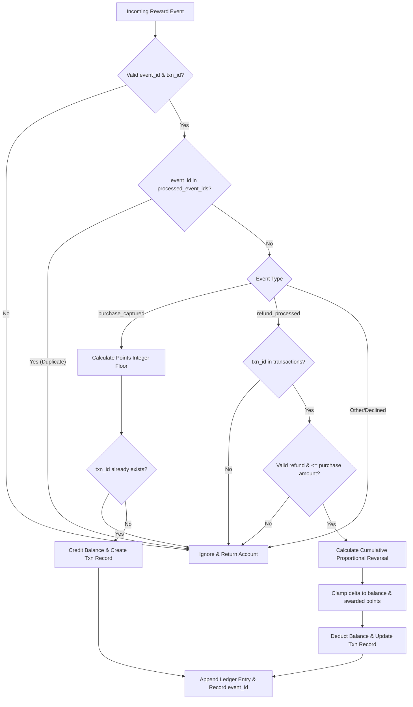

# Architecture Notes

## Project map
- `models.py`: Data structure factory for account objects (`new_account`). Defines core account schema including points balance, processed event IDs, transaction records, and audit ledger.
- `service.py`: Business logic engine containing:
  - `calculate_points`: Core integer floor points calculation with promotional bonuses and caps.
  - `apply_reward_event`: Event processor handling purchase captures, refund reversals, deduplication, ledger writes, and balance updates.
  - `flag_repeat_transactions`: Compliance monitoring routine grouping transactions by account, date, and amount to detect duplicate execution patterns.
  - `generate_account_statement_csv`: Financial reporting utility exporting transaction history and running balances.
- `fixtures.py`: Default test fixtures and synthetic data generators for offline demonstrations.
- `main.py`: Offline runner demonstrating the end-to-end pipeline from points calculation to ledger event processing and statement generation.
- `tests/`: Automated test suite containing contract tests (`test_contract.py`), acceptance matrix tests (`test_acceptance_matrix.py`), and regression tests (`test_regression.py`).
- `data/`: Expanded synthetic dataset (`records.json`) containing 40 accounts, 180 repeat-transaction records, 264 reward events, 180 captured purchases, 8 rule cases, and 10 edge-case categories.

## Data model
- **Account Dictionary Schema:**
  ```python
  {
      'account_id': str,           # Unique customer account identifier
      'points_balance': int,       # Current non-negative loyalty points balance
      'processed_event_ids': list, # Ordered list of ingested unique event_ids for idempotency
      'transactions': dict,        # Mapping of txn_id -> transaction state record
      'ledger': list               # Chronological append-only list of balance mutations
  }
  ```
- **Transaction Record Schema:**
  ```python
  {
      'amount_paise': int,    # Original purchase amount in paise
      'awarded_points': int,  # Initial points credited
      'reversed_points': int, # Cumulative points reversed across refunds to date
      'refunded_paise': int   # Cumulative amount refunded in paise to date
  }
  ```
- **Ledger Entry Schema:**
  ```python
  {
      'event_id': str,     # Ingested event identifier
      'type': str,         # Event kind ('purchase_captured' or 'refund_processed')
      'points_delta': int  # Signed points adjustment (+N for earn, -N for refund)
  }
  ```

## Data flow
1. **Event Ingestion:** An incoming event dictionary is passed to `apply_reward_event(account, event, rules)`.
2. **Pre-flight Validation & Idempotency:**
   - Account and event structures are validated.
   - If `event_id in account['processed_event_ids']`, processing terminates immediately (no duplicate processing).
3. **Event Routing:**
   - *Purchase Captured:* Points are computed via `calculate_points`. If `transaction_id` is new, transaction state is initialized, `points_balance` is credited, ledger entry is appended, and `event_id` is recorded.
   - *Refund Processed:* Verified against existing transaction record. Refund amount is validated against remaining un-refunded balance. Proportional reversal delta is calculated, clamped against available balance and awarded points, deducted from `points_balance`, recorded in the ledger, and `event_id` is recorded.
4. **Repeat Detection:** In parallel, batch transaction streams pass through `flag_repeat_transactions` to group identical payments for human review without interrupting settlement.

## Storage design
The current offline design utilizes immutable in-memory dictionary structures with `copy.deepcopy()` isolation to ensure zero mutation of input objects. In a production architecture, this maps cleanly to an Event Sourcing pattern:
- **Event Store:** Append-only log of immutable reward events (`purchase_captured`, `refund_processed`).
- **Read Model / Materialized View:** Account aggregate holding `points_balance` and active `transactions`.
- **Audit Table:** Immutable ledger table with running balances.

## Diagram


## Three improvements suggested
1. **Event-Sourced Architecture with Append-Only Storage:** Transition from in-memory state manipulation to an append-only event store backed by PostgreSQL or Apache Kafka, enabling full audit point-in-time replay and disaster recovery.
2. **Distributed Idempotency Cache:** Introduce a distributed Redis cache with TTL to track `processed_event_ids` for $O(1)$ fast-path duplicate event rejection in high-throughput clusters.
3. **Configurable Loyalty Rule Engine:** Abstract the hard-coded points calculation into a declarative rules engine supporting tiered merchant categories, seasonal campaign multipliers, and time-bound promotional point expirations.
