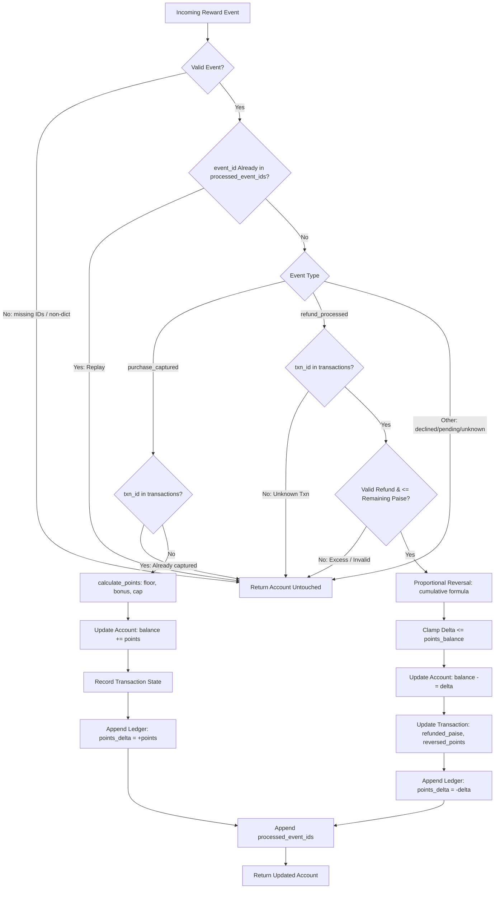
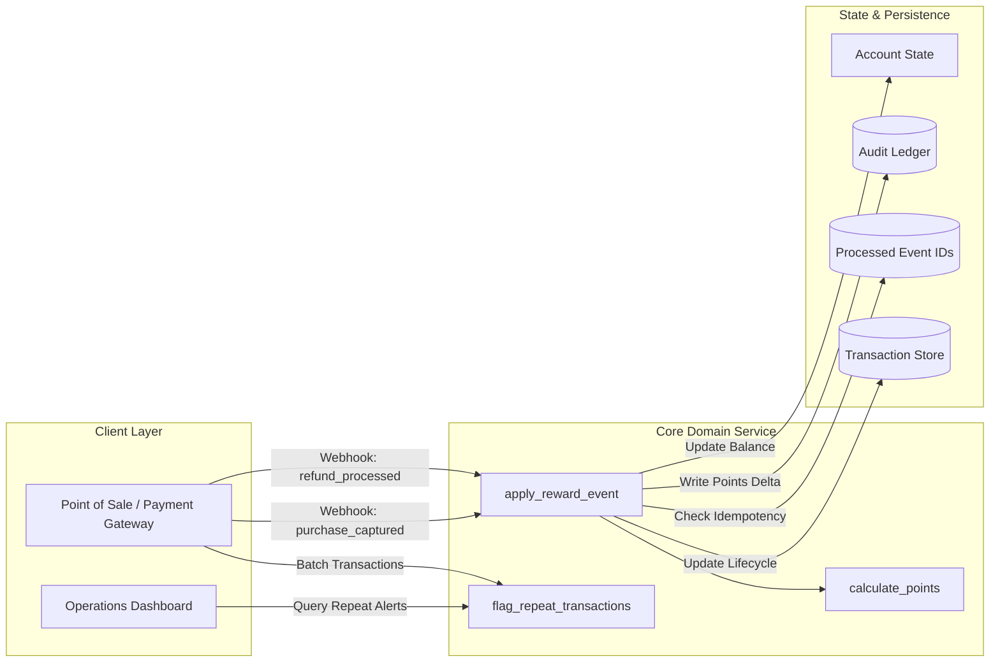

# Architecture Notes — RewardBook

## Project map

```text
RewardBook-Open-Source-Evaluation-fork/
├── service.py                  # Core domain logic: points formula, event processing, repeat alerts
├── models.py                   # Data constructors: new_account schema factory
├── fixtures.py                 # Sample entities for local execution and offline tests
├── main.py                     # Offline entrypoint demonstrating points calculation and repeat alerts
├── data/
│   ├── README.txt              # Dataset documentation and schema description
│   └── records.json            # 40 accounts, 180 repeat records, 264 reward events, 8 rule cases
├── tests/
│   ├── test_contract.py        # Core behavioral contracts and invariant assertions
│   ├── test_acceptance_matrix.py # Parametrized acceptance tests covering permutations
│   └── test_regression.py      # 15 regression test cases for edge cases, null-traps, and boundaries
├── docs/
│   └── Problem_Statement.pdf   # Compiled student problem statement
├── approach.md                 # Required deliverable: engineering approach & experiments (5 marks)
├── challenges.md               # Compulsory deliverable: debugging obstacles & evidence (5 marks)
├── optimizations.md            # Required deliverable: performance & trade-off analysis (5 marks)
├── TESTING.md                  # Required deliverable: test environment & edge-case catalog
├── REWARD_RULE_NOTES.md        # Required deliverable: worked points calculation & refund math
├── PROJECT_NOTES_TEMPLATE.md   # High-level project summary and requirement checklist
└── ARCHITECTURE_TEMPLATE.md    # System architecture, data flow, and design review
```

---

## Data model

The service operates on three primary entity schemas:

### 1. Account (`dict`)
Represents customer loyalty state and the audit ledger:
- `account_id` (`str`): Unique account identifier (e.g. `"ACCT-1001"`).
- `points_balance` (`int`): Current balance of earned reward points ($\ge 0$).
- `processed_event_ids` (`list[str]`): Sequential record of all executed event IDs guaranteeing idempotency.
- `transactions` (`dict[str, dict]`): Mapping of `transaction_id` to its lifecycle tracking state:
  - `amount_paise` (`int`): Original purchase amount in paise.
  - `awarded_points` (`int`): Base + bonus points originally credited.
  - `reversed_points` (`int`): Total points reversed across all refunds to date.
  - `refunded_paise` (`int`): Cumulative paise refunded to date ($\le \text{amount\_paise}$).
- `ledger` (`list[dict]`): Immutable, append-only log of point mutations:
  - `event_id` (`str`): Triggering event identifier.
  - `type` (`str`): Event type (`"purchase_captured"`, `"refund_processed"`).
  - `points_delta` (`int`): Signed points modification ($> 0$ for capture, $< 0$ for refund).

### 2. Reward Event (`dict`)
Incoming transaction event emitted by upstream payment processors:
- `event_id` (`str`): Globally unique event identifier (e.g. `"RW-EV-0001"`).
- `type` (`str`): Event lifecycle status (`"purchase_captured"`, `"refund_processed"`, `"purchase_declined"`, `"purchase_pending"`, `"unknown"`).
- `transaction_id` (`str`): Associated commercial transaction identifier (e.g. `"TX-1001"`).
- `amount_paise` (`int`): Transaction value in paise.
- `account_id` (`str`, optional): Associated customer account.

### 3. Reward Rules (`dict`)
Promotional campaign parameters applied during points evaluation:
- `points_per_100_rupees` (`int`): Base rate multiplier per ₹100 (10,000 paise).
- `bonus_percent` (`int`): Percentage uplift added to base points.
- `cap_points` (`int | None`): Maximum allowable points per purchase event.

---

## Data flow



1. **Ingress & Defensive Validation:** The incoming event dictionary is inspected for required keys (`event_id`, `transaction_id`, `type`). If identifiers are missing, malformed, or blank, execution terminates with zero mutations.
2. **Idempotency Gate:** If `event_id` exists in `processed_event_ids`, the event is a duplicate replay and is discarded immediately.
3. **Branching on Event Kind:**
   - **Captured Purchase:** Validates that `txn_id` has not been captured previously. Computes points using integer floor division, updates `points_balance`, initializes the transaction tracking record, appends an audit ledger record, and appends `event_id`.
   - **Processed Refund:** Verifies `txn_id` exists. Rejects invalid amounts ($0$, negative, non-integers) and excess refunds where `refunded_paise + refund > amount_paise`. Computes proportional reversal cumulatively, clamps deduction so `points_balance` never goes negative, updates transaction metrics, appends a negative ledger record, and appends `event_id`.
   - **Declined / Pending / Unknown Events:** Excluded from points awards or ledger entries; returns account unchanged.

---

## Storage design

### Current In-Memory Model
- State is modeled as nested Python dictionaries passed functional-style into `apply_reward_event()`.
- Deep copying (`deepcopy`) ensures caller isolation and prevents accidental in-place mutation.
- The append-only `ledger` array maintains audit traceability, satisfying the mathematical invariant:
  $$\text{points\_balance} = \sum_{e \in \text{ledger}} e[\text{points\_delta}]$$

### Target Relational Storage Architecture (Production)
For a production deployment, this model maps cleanly to relational tables with ACID guarantees:

1. **`accounts` Table:**
   - `account_id VARCHAR PRIMARY KEY`
   - `points_balance BIGINT NOT NULL CHECK (points_balance >= 0)`
   - `created_at TIMESTAMP WITH TIME ZONE DEFAULT NOW()`

2. **`processed_events` Table (Idempotency):**
   - `event_id VARCHAR PRIMARY KEY`
   - `account_id VARCHAR REFERENCES accounts(account_id)`
   - `processed_at TIMESTAMP WITH TIME ZONE DEFAULT NOW()`

3. **`transactions` Table (Lifecycle Tracking):**
   - `transaction_id VARCHAR PRIMARY KEY`
   - `account_id VARCHAR REFERENCES accounts(account_id)`
   - `amount_paise BIGINT NOT NULL`
   - `awarded_points BIGINT NOT NULL`
   - `refunded_paise BIGINT NOT NULL DEFAULT 0`
   - `reversed_points BIGINT NOT NULL DEFAULT 0`
   - `CONSTRAINT valid_refund CHECK (refunded_paise <= amount_paise)`

4. **`reward_ledger` Table (Append-Only Audit Log):**
   - `ledger_id BIGSERIAL PRIMARY KEY`
   - `account_id VARCHAR REFERENCES accounts(account_id)`
   - `event_id VARCHAR NOT NULL`
   - `type VARCHAR NOT NULL`
   - `points_delta BIGINT NOT NULL`
   - `created_at TIMESTAMP WITH TIME ZONE DEFAULT NOW()`

---

## Diagram: System Architecture



---

## Three improvements suggested

### 1. Append-Only Event Sourcing
- **Current Limitation:** The current account dictionary stores both materialized state (`points_balance`, `transactions`) and historical state (`ledger`, `processed_event_ids`).
- **Proposed Solution:** Transition to an Event Sourcing pattern where the `ledger` is the sole source of truth. Current `points_balance` and transaction refund limits are derived projections (read models) computed by folding the event stream. This provides complete non-repudiation, disaster recovery, and point-in-time auditing.

### 2. Rolling Time-Window for Repeat Alerts
- **Current Limitation:** `flag_repeat_transactions()` groups strictly by calendar date string (`date`), missing repeat transactions that occur across midnight (e.g. 23:55 and 00:05).
- **Proposed Solution:** Accept ISO-8601 timestamps and evaluate repeats using a rolling sliding window (e.g., $N$ transactions within a configurable 24-hour window) using a double-ended queue or time-bucket algorithm.

### 3. Concurrency Control with Atomic Transitions
- **Current Limitation:** The service executes synchronously in a single thread. In a multi-worker production environment, two concurrent refund webhooks could cause a race condition leading to over-refunds or negative balances.
- **Proposed Solution:** Implement optimistic concurrency control with an `account_version` column (`WHERE account_version = :expected_version`) or database row-level locking (`SELECT FOR UPDATE`) on the account record during event application.
