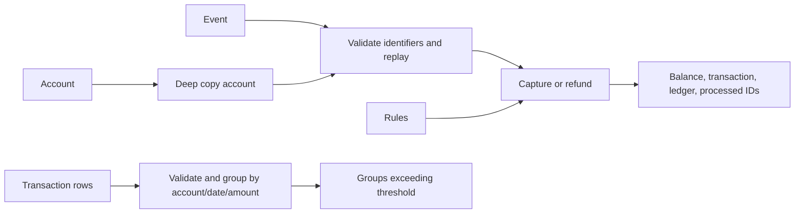

# Architecture notes

## Project map
- `service.py`: pure-style rewards calculation, copied-account event updates, repeat warnings.
- `models.py`: account factory.
- `fixtures.py` / `main.py`: small offline demo.
- `data/records.json`: larger synthetic examples; `data/README.txt`: schema summary.
- `tests/`: contract and parameterized acceptance tests.
- `.github/workflows/tests.yml`: Python 3.11 demo, pytest and published counts.

## Data model
Account dictionary: `account_id`, `points_balance`, `processed_event_ids` list, `transactions` dictionary, `ledger` list. Each transaction stores amount, awarded/reversed points and cumulative refunded paise. Ledger entries store event ID, type and signed points delta. Repeat warnings list account, date, amount and transaction IDs.

## Data flow

## Storage design
In-memory dictionaries/lists only. Caller state is deep copied. No database, network service or durable/atomic event store. Processed IDs are scoped to the supplied account.

## Three suggested improvements
1. Validate identifiers and complete account schemas; test malformed nested values.
2. Benchmark event-history growth before introducing a processed-ID index or structural copying.
3. If persisted, atomically commit ledger/balance/idempotency state with uniqueness constraints.

These are unimplemented review suggestions. Notes prepared with Codex assistance.
